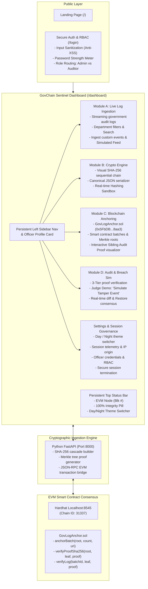

# GovChain Sentinel 🛡️⚡
> **Immutable Government Audit & Chain of Custody System**

A full-stack, enterprise-grade Cybersecurity SOC application for federal, municipal, and regulatory record keeping. Implements continuous SHA-256 cryptographic hash-chaining, balanced binary Merkle tree proofs, and Ethereum Virtual Machine (EVM) smart contract consensus.

---

## 🏛️ System Architecture

---

## 🚀 Active Services & Endpoints

| Service | Port / URL | Status | Description |
| :--- | :--- | :--- | :--- |
| **Public Landing Page** | [http://localhost:3000/](http://localhost:3000/) | 🟢 **Live** | High-impact hero, value proposition grid, and portal entry |
| **Secure Login / Auth** | [http://localhost:3000/login](http://localhost:3000/login) | 🟢 **Live** | Input-sanitized login/registration with password meter & RBAC |
| **Main SOC Dashboard** | [http://localhost:3000/dashboard](http://localhost:3000/dashboard) | 🟢 **Live** | Full 4-module dashboard with persistent sidebar and status bar |
| **FastAPI Backend API** | [http://127.0.0.1:8000](http://127.0.0.1:8000) | 🟢 **Live** | SHA-256 hash chaining, Merkle tree builder & JSON-RPC bridge |
| **Interactive API Docs** | [http://127.0.0.1:8000/docs](http://127.0.0.1:8000/docs) | 🟢 **Live** | Interactive Swagger OpenAPI documentation |
| **Local EVM Node** | `http://127.0.0.1:8545` | 🟢 **Live** | Hardhat EVM local node (Chain ID: 31337) |
| **Smart Contract** | `0x5FbDB2315678afecb367f032d93F642f64180aa3` | 🟢 **Deployed** | `GovLogAnchor.sol` immutable batch root anchor |

---

## 🔑 Demo Access Credentials (Hackathon Judges)

The portal provides **1-Click Quick Access** buttons on the `/login` screen:

| Role | Email | Password | Permissions |
| :--- | :--- | :--- | :--- |
| **Admin (System Security Controller)** | `admin@sentinel.gov` | `Admin@2026!SecOps` | Full authority: simulate tamper events, force on-chain batch anchors, ingest events |
| **Normal User (Auditor / Agency Officer)** | `auditor@sentinel.gov` | `Auditor@2026!Inspect` | Audit access: inspect live stream, run mathematical verifier, view telemetry |

---

## 🔬 Hackathon Judge Tour & Features

1. **Visit [http://localhost:3000/](http://localhost:3000/)**: Explore the public landing page explaining why public sector records require blockchain anchoring.
2. **Access the Portal [http://localhost:3000/login](http://localhost:3000/login)**:
   - Try typing `<script>` or malicious HTML into the input fields to see real-time anti-XSS sanitization in action.
   - Test password strength meter (minimum 8 chars, uppercase, lowercase, numbers, symbols).
   - Use the 1-Click Demo button to sign in as **Admin** or **Auditor**.
3. **Navigate the Core Modules [http://localhost:3000/dashboard](http://localhost:3000/dashboard)**:
   - **Module A (Live Ingestion)**: Filter logs by department (Land Registry, Treasury, Defense, Judiciary, Health) or click **"Simulate Incoming Telemetry"**.
   - **Module B (Crypto Engine)**: Inspect the sequential SHA-256 chain topology and test the interactive hashing sandbox.
   - **Module C (Blockchain Anchoring)**: View on-chain batch IDs, block numbers, transaction hashes, and the interactive Merkle tree audit path.
   - **Module D (Audit & Breach Sim)**: Click **"Simulate Tamper Event"** to see instant breach detection and side-by-side cryptographic diff, then click **"Restore From On-Chain Immutable Truth"**.
4. **Settings & Session Controls**:
   - Toggle between **Cyber Defense SOC (Dark)** and **Daylight Audit Mode (Light)**.
   - Inspect active session telemetry (session start, IP origin `10.142.4.92`, token ID).
   - Test **"Switch Account"** and **"Logout Session"**.
